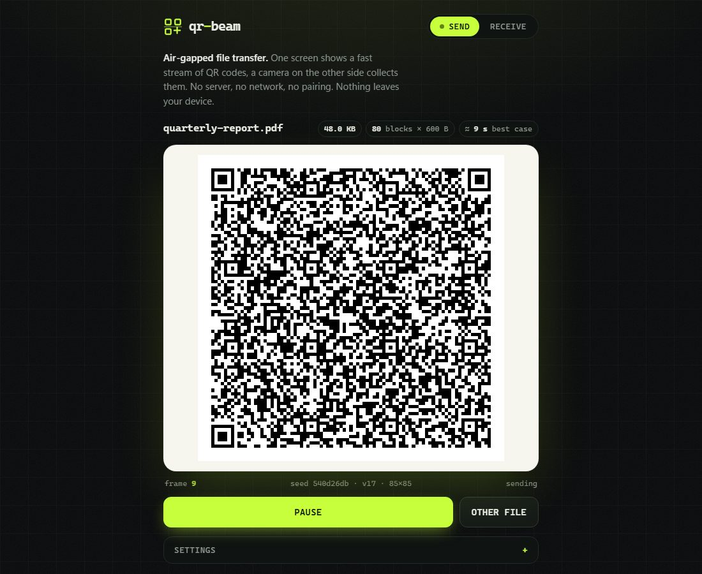
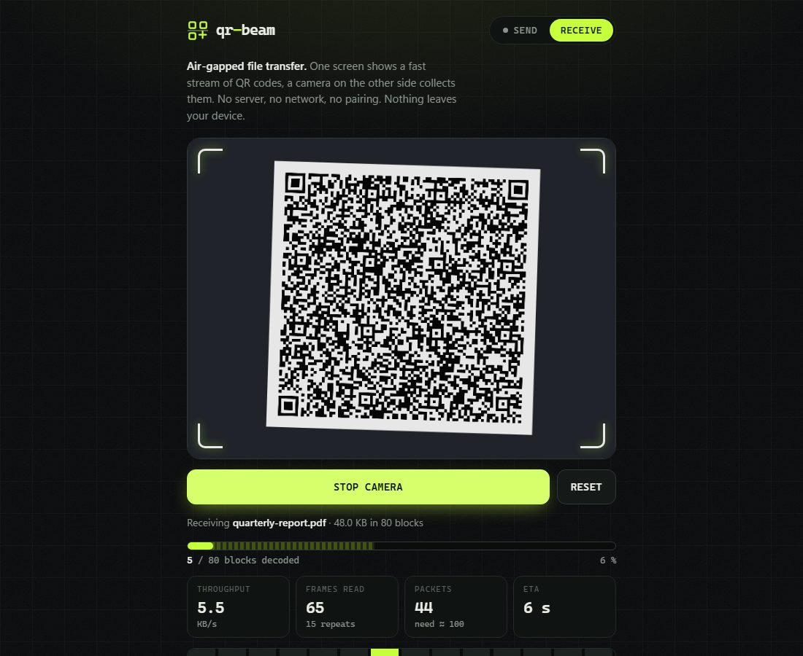

# qr-beam

**Air-gapped file transfer in a single HTML file.**

[](https://github.com/bernhardbrugger/qr-beam/actions/workflows/ci.yml)
[](LICENSE)

### [▶ Live demo: bernhardbrugger.github.io/qr-beam](https://bernhardbrugger.github.io/qr-beam/)

<!-- TODO: record a short screen+phone capture and save it as docs/demo.gif -->
<p align="center">
  
</p>

One screen shows a fast stream of QR codes, a camera on the other side collects them and rebuilds
the file. No server, no network, no Bluetooth, no pairing, no install. `index.html` is the whole
app: HTML, CSS, JavaScript and both libraries are inline, there are no CDNs and no build step.

| Send | Receive |
|---|---|
|  |  |

## Use it

1. Open the page on **both** devices. The receiving device needs a camera, and browsers only
   allow camera access on **HTTPS or `http://localhost`** (the live demo is HTTPS).
2. **Send:** drop a file on the page (or tap to choose one). The QR stream starts immediately.
3. **Receive:** open the *Receive* tab, tap *Start camera*, hold the phone steady and aim it at the
   sender's screen. Frames can be missed freely; the progress bar and block map fill up.
4. When the SHA-256 matches, tap *Download*. The file keeps its original name.

Fully offline: save `index.html`, then serve it from the machine itself, e.g.
`python -m http.server 8000` and open `http://localhost:8000`. Nothing is ever fetched or uploaded.

Settings (sender, under *Settings*): block size (default 600 B), frame rate (default 12 fps) and QR
error correction (L or M, default L). The receiver needs no configuration, everything it needs is
inside the packets.

## How it works, in plain words

A normal "QR slideshow" cuts the file into numbered pieces and shows them in order. Miss one piece
and you wait for the whole loop to come round again; with a shaky hand and a 12 fps stream you
*will* miss pieces.

qr-beam uses a **fountain code** (an *LT code*, Luby 2002) instead:

* The file is cut into *K* equal blocks.
* The sender never repeats blocks. Each frame carries a fresh *mixed packet*: the XOR of a small,
  random-looking handful of blocks. Which blocks went into a packet is fully determined by a 32-bit
  **seed** in the packet header, so the receiver can recompute the recipe.
* A receiver can start at any time, miss any frames, and only needs roughly **K + 5-12 %** packets, *any*
  ones. Which frames were lost does not matter, it is like a fountain: hold your cup under it until
  it is full.
* Decoding is a puzzle: a packet that mixes only one block *is* that block. Subtract known blocks
  from the other packets and repeat (peeling). If peeling stalls near the end, the remaining few
  equations are solved by Gaussian elimination over GF(2).
* How many blocks go into a packet follows the *Robust Soliton distribution*, which makes sure
  that easy packets keep appearing during decoding.
* Every packet has a CRC-32, so a garbled read is dropped instead of poisoning the result, and the
  final file is checked against a **SHA-256** carried in the metadata frames.

### Packet format (version 1)

QR codes use byte mode, error correction L (default) or M. Big-endian:

| Offset | Size | Field |
|---|---|---|
| 0 | 1 | magic `0xB7` |
| 1 | 1 | version (high nibble) \| type (low nibble): 0 = data, 1 = metadata |
| 2 | 4 | file size in bytes |
| 6 | 2 | block size in bytes |
| 8 | 2 | number of blocks *K* |
| 10 | 4 | seed (0 for metadata) |
| 14 | 4 | first 4 bytes of the file's SHA-256, keeps different transfers apart |
| 18 | n | data: XOR of the chosen blocks (exactly one block size). Metadata: SHA-256 (32) · MIME length (1) · MIME · name length (1) · UTF-8 file name |
| end | 4 | CRC-32 of everything before it |

Frame 0 and every 16th frame afterwards are metadata packets (about 6 % of the stream), so a
receiver learns the file name and full SHA-256 within about a second and a half at 12 fps.

## Measured numbers

> **Read this first:** I have *not* measured qr-beam with a physical phone yet. Everything below comes
> from `npm run bench` and the unit tests: headless Chromium on one Windows PC, the real UI on both
> sides, sender and receiver in separate browser processes, a simulated camera (1280×720, QR code
> slightly rotated and resampled, JPEG-compressed snapshots). That simulated camera only delivers
> about 10 frames per second, so rows above ~10 fps are capture-limited. Run-to-run variation is
> roughly ±30 %. 1 KB = 1000 bytes.

**End-to-end, 60 KB file, verified byte-exact (one run, `npm run bench`):**

| Block | Frame rate | ECC | QR version | Raw rate (block × fps) | Measured goodput | Time for 60 KB | jsQR time per frame |
|---|---|---|---|---|---|---|---|
| 300 B | 12 fps | L | 12 | 3.6 KB/s | 2.3 KB/s | 26.0 s | 40 ms |
| 600 B | 6 fps | L | 17 | 3.6 KB/s | 3.0 KB/s | 19.7 s | 52 ms |
| **600 B (default)** | **12 fps (default)** | **L** | 17 | 7.2 KB/s | **3.9 KB/s** | 15.3 s | 55 ms |
| 600 B | 12 fps | M | 19 | 7.2 KB/s | 4.7 KB/s | 12.8 s | 58 ms |
| 600 B | 20 fps | L | 17 | 12.0 KB/s | 4.7 KB/s | 12.8 s | 55 ms |
| 1000 B | 12 fps | L | 26 | 12.0 KB/s | 5.3 KB/s | 11.3 s | 98 ms |
| 1500 B | 10 fps | L | 28 | 15.0 KB/s | 6.7 KB/s | 9.0 s | 104 ms |

Expect single-digit KB/s, i.e. a few seconds per 10 KB or a few minutes per megabyte. Bigger
blocks look faster here because the simulated camera sees a clean, large, flat QR code; a real phone
at arm's length has to resolve far smaller modules, so the large-block rows are the ones most
likely to fall apart in reality (version 28 is 129×129 modules).

**Fountain-code overhead** (packets a receiver needs beyond *K*, from `test/core.test.js`; lossless
channel, so it measures the code, not the camera):

| K blocks | 2 | 10 | 50 | 200 | 1000 | 4000 |
|---|---|---|---|---|---|---|
| average extra packets | 29 % | 18 % | 10 % | 5 % | 12 % | 11 % |

Small and medium files finish with Gaussian elimination, which is why *K* ≤ ~600 does well. Above
that the decoder falls back to pure peeling and sits around 11-12 %. On top of that come the metadata
frames (1 in 16) and whatever the camera misses.

**Decode cost:** jsQR needs 30-105 ms per frame in the simulation (desktop CPU). After the first hit
the receiver only scans a downscaled region around the code. A slower phone may be limited by this
rather than by the sender's frame rate.

## Limitations

* **Camera needs HTTPS or localhost.** On a plain `http://` page the Receive tab is disabled. The
  Send tab works anywhere (SHA-256 falls back to a built-in implementation without WebCrypto).
* **Not tested on real phones or real cameras yet** (see above). Dense QR codes depend on screen
  brightness, glare, moiré, focus and how steady the hand is. If it struggles, lower the block size
  (300-400 B is far easier to read) and the frame rate.
* **Slow by design.** Single-digit KB/s. Sensible for configs, keys, small documents and small
  images; not for videos. At most 65 535 blocks per file (39 MB at 600 B), and the whole file is held
  in memory on both sides.
* **No encryption, no authentication.** Anyone who can see the sender's screen gets the file. The
  SHA-256 protects against corruption, not against a malicious sender.
* **jsQR 1.4.0 cannot read QR version 23 at error-correction level L** (verified with clean renders;
  an independent decoder, ZXing, reads the same symbol). The sender writes such frames at level M, which
  only matters for block sizes around 1000 B.
* **Native `BarcodeDetector`** (Chrome on Android, macOS) is used when it reports QR support, but it
  returns text rather than bytes. Every packet therefore carries a CRC-32; if the detector's output
  fails it three times in a row while jsQR succeeds, the receiver switches to jsQR for good. This
  logic is tested against simulated detectors only, not against a real one.
* iOS Safari has no `BarcodeDetector`; jsQR is used there (also untested on a real device).
* One transfer at a time: the receiver locks onto the first file it sees; use *Reset* to switch.
  One sender can feed any number of receivers at once.
* The wire format is version 1 and may still change; sender and receiver must run the same version.
* Sender and receiver derive packet recipes from the seed with `Math.log`/`Math.sqrt`-based tables
  quantised to integers; a JS engine with different rounding could in theory disagree on a
  vanishingly rare packet, which the final SHA-256 would catch.

## Development

```bash
npm ci
npx playwright install chromium
npm test              # unit tests + Playwright end-to-end tests
npm run screenshots   # re-render docs/*.jpg
npm run bench         # throughput simulation, see above
npm run vendor        # refresh the inlined libraries from node_modules
```

| Path | What |
|---|---|
| `index.html` | the whole app (`#qrbeam-core` = protocol + fountain code, `#qrbeam-app` = UI) |
| `test/core.test.js` | Node tests: fountain code with 30 % loss for many sizes (0 B, 1 B, ...), packet format, SHA-256, QR byte-mode round trip |
| `test/e2e.test.js` | Playwright: sender canvas → jsQR → session, and a fake camera filming the sender through the real UI |
| `scripts/` | screenshots, benchmark, library vendoring |

The Node tests extract the `<script id="qrbeam-core">` block from `index.html` and run it unchanged,
so what is tested is what ships. CI runs the tests on every push; pushes to `main` that pass are
deployed to GitHub Pages (only `index.html` is published).

## Credits

* [qrcode-generator](https://github.com/kazuhikoarase/qrcode-generator) by Kazuhiko Arase, MIT: QR code generation (inlined, unmodified).
* [jsQR](https://github.com/cozmo/jsQR) by Cosmo Wolfe et al., Apache-2.0: QR code detection fallback (inlined, unmodified).
* Michael Luby, *LT Codes*, FOCS 2002: the fountain code and the Robust Soliton distribution.
* The browser's native [`BarcodeDetector`](https://developer.mozilla.org/en-US/docs/Web/API/BarcodeDetector) is used when available.

Full license texts of the embedded libraries: [THIRD_PARTY_LICENSES.md](THIRD_PARTY_LICENSES.md).
"QR Code" is a registered trademark of DENSO WAVE INCORPORATED.

## License

[MIT](LICENSE) © 2026 bernhardbrugger
